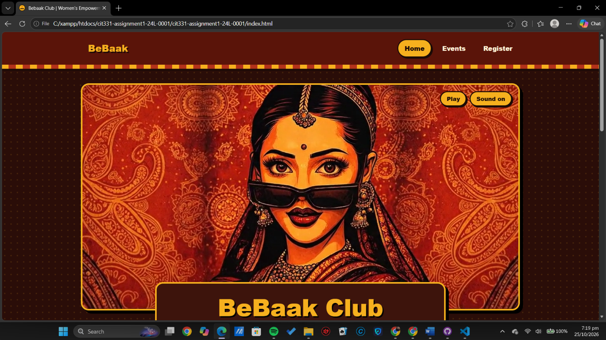

# BeBaak Club

**CIT331 Web Technologies, Assignment 1 (Part B)**

Live site: https://malaikaatahir.github.io/cit331-assignment1-24L-0001/



## About the club

BeBaak ("the light of women") is a university women's empowerment club website with a desi pop-art theme. Its landing page opens with an animated illustration of a woman in a red saree lowering her sunglasses, and the whole site uses the colours of that video: maroon, saffron, rust and teal with black ink outlines. Visitors can read about the club, browse four upcoming events and register for one. Registrations are saved in the browser with localStorage and shown in a table on the same page.

## Pages

| Page | File | What it has |
|------|------|-------------|
| Home | `index.html` | Landing video, club description, featured event, links to other pages |
| Events | `events.html` | Four events, each with title, date, location and description |
| Register | `register.html` | Validated registration form, saved registrations table, "Clear all" button |

## Project structure

```
index.html
events.html
register.html
css/style.css
js/register.js
js/hero.js
images/
screenshots/
```

## Run it locally

1. Download or clone the repository: `git clone https://github.com/malaikaatahir/cit331-assignment1-24L-0001.git`
2. Open the folder and double-click `index.html` (or right-click it and choose Open with your browser).
3. No build step or server is needed.

## Technologies

HTML5, CSS3 (Flexbox, media queries, `prefers-color-scheme`) and plain JavaScript (localStorage).

## Author

Zainab Tahir, Roll No. F24-BSCS-0001
